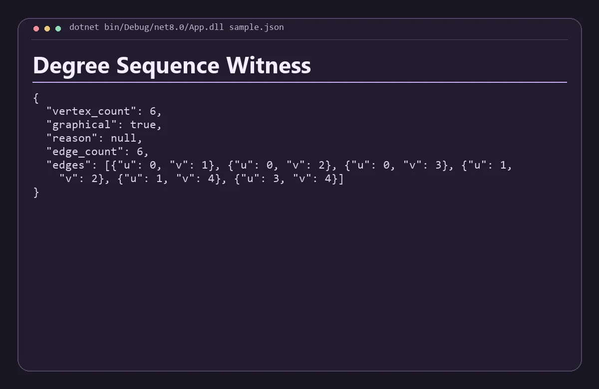

# Degree Sequence Witness

Test whether a list of degrees can describe a simple undirected graph and build a concrete edge list when it can.



## Run

Install .NET 8 SDK and runtime. Run these commands from the repository root.

```sh
dotnet build --nologo
dotnet bin/Debug/net8.0/App.dll sample.json
```

Replace `sample.json` with a JSON file following the same structure. The app prints a JSON report to standard output.

Each nonnegative integer is the required degree of the vertex at that zero-based array position. The Havel–Hakimi construction repeatedly joins a highest-degree vertex to the highest remaining degrees, using the original position to break ties. The witness lists edges in vertex order and keeps isolated vertices in the reported vertex count. Non-graphical sequences include an explanation code.

## Verify

Run `python check.py` with Python 3.11 or newer after the build step when applicable. The check verifies the bundled scenario and confirms that an invalid input returns an error.
